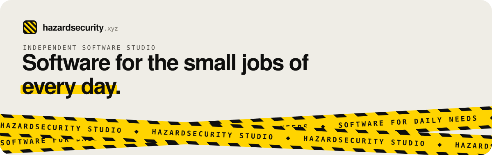

<h2 align="left">Hi, I'm Michael 👋</h2>

  I'm a software engineer running <a href="https://hazardsecurity.xyz"><b>Hazardsecurity</b></a>, an independent studio that builds focused software for everyday jobs.
  Each tool does one job properly: private by default, quick to learn, fairly priced, with interfaces that feel good to use.

  
  
  <!-- Add your links, e.g.:
  
  
  -->

### 🧰 On the shelf

<table>
  <tr>
    <td width="52%" valign="top">
      
    </td>
    <td valign="top">
      <h3><a href="https://sign.hazardsecurity.xyz">HazardSign AI</a></h3>
      
Sign any file online: PDFs, photos, spreadsheets, anything. Documents are signed and sealed in the browser and <b>never leave the device</b>. Every copy carries an audit certificate with its SHA-256 fingerprint and a server-issued receipt.

      

        <code>Next.js</code> <code>Motion</code> <code>Postgres</code> <code>pdf.js</code> <code>pdf-lib</code> <code>Paystack</code>
      

      
<b>₦500 / month</b> · <a href="https://sign.hazardsecurity.xyz">sign.hazardsecurity.xyz</a>

    </td>
  </tr>
</table>

More tools are in the workshop. Each one ships as its own product on a `*.hazardsecurity.xyz` subdomain.

### ✨ Interactive design

I treat motion as part of the product, not decoration. A few things I've built recently:

- **A self-signing hero:** on HazardSign, a contract signs itself stroke by stroke, a seal stamps down on a spring, and the document's fingerprint decodes from noise into its real SHA-256.
- **Hazard tape that reacts to you:** on [hazardsecurity.xyz](https://hazardsecurity.xyz), two strips of caution tape cross the hero and speed up or reverse with your scroll velocity ([source](https://github.com/hazardsecurity/hazardsecurity-studio)).
- **Scroll-driven storytelling:** a pinned "how it works" stage where each scroll step swaps a live scene.
- **Your name as a signature:** on sign-up, the name you type is written out live as your signature.
- **Small touches throughout:** letter-roll buttons with an arrow that fires and reloads, an envelope that folds shut when you ask for a reset link, and a paywall seal that unlocks.
- **A design library behind it:** labelled notes on how great sites are engineered (tokens, scroll systems, shaders, text motion), with a React + Motion playbook I draw on for every build.

### ⚡ How I build

- Ship something real, then sharpen it
- Security by default: hashed secrets, httpOnly sessions, signed webhooks, least access
- Considered typography and motion, never templates
- Respect for reduced motion and small screens

### 🛠 Languages and tools

  

### 📫 Get in touch

Have a daily chore software should handle? Visit [hazardsecurity.xyz](https://hazardsecurity.xyz) or open an issue on [hazardsecurity-studio](https://github.com/hazardsecurity/hazardsecurity-studio).
